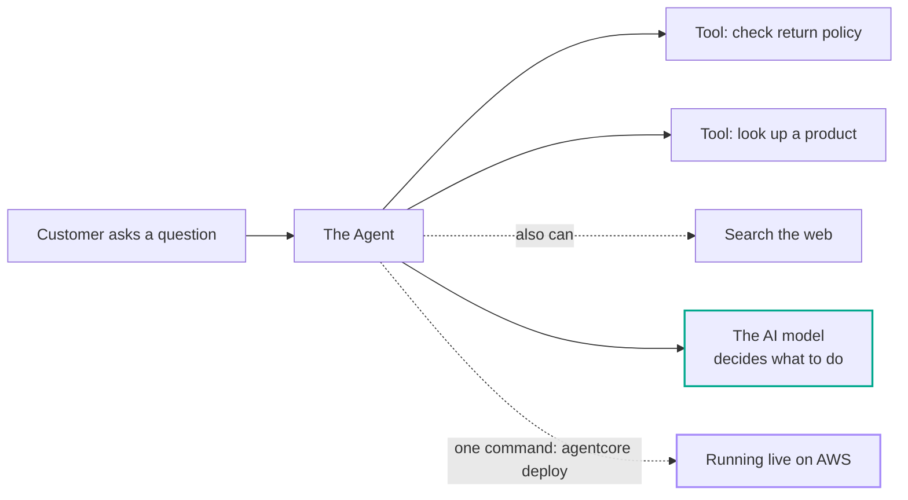

# Lab 1 — Building the Agent Prototype

## The problem, in plain terms

You can ask an AI model a question and it'll give you a smart-sounding answer. But a model by itself can't actually *do* anything — it can't look up a real order, check a real policy, or search the web. It just talks. To get something that can act, you need to give it tools and a place to run.

## Why this actually matters

Think about a customer support chatbot that can only chat. A customer asks "what's your return policy for my headphones?" and the bot either makes something up (bad) or says "I can't help with that, please call support" (also bad, and the whole point of building it was to avoid that call). That's the gap between a model and an agent — and it's the gap that makes a lot of "AI features" feel like a shiny toy instead of something actually useful.

## What AWS gives you to fix this

Amazon Bedrock AgentCore handles this by cleanly separating two jobs: the model's job (think and decide what to do) and the agent's job (actually do it). You write small Python functions — called "tools" — that do real things, like look up a product. The agent decides when to call them. AWS also gives you a one-command way to package all this up and run it in the cloud, so you don't have to build that infrastructure yourself.

## What I actually did

1. Ran one command (`agentcore create`) to generate a starting project — this gives you a working agent with a sample tool already wired up, so you're not starting from a blank file.
2. Swapped the sample tool out for two real ones: a return-policy lookup and a product-info lookup.
3. Locked the AI model to one specific version, so it behaves the same way in every later lab.
4. Tested it on my own machine first (`agentcore dev`) — this gives you instant feedback without paying for or waiting on the cloud.
5. Deployed it to AWS with one command (`agentcore deploy`) — AWS handles the permissions and infrastructure setup in the background.

## How it fits together

*This diagram is my own, drawn to explain what this lab builds — not an official AWS diagram. Source: AWS Workshop Studio, Lab 1 ("Building the Agent Prototype").*

## The one thing worth remembering

An agent is not just "a model with a nice chat box." It's a model *plus* tools *plus* somewhere to run. This lab only builds that minimum — it doesn't remember past conversations, can't use another team's existing systems yet, and has no security or quality checks. That's on purpose: every lab after this one adds exactly one of those missing pieces. If someone shows you an "agent" that's really just a chatbot wrapped around one model call, now you know exactly what's missing.

## What I actually tested, not just read about

I ran every step above myself, including a real deploy to AWS. I confirmed the local test server worked (`agentcore dev`) and that the deployed version answered correctly when I called it with `agentcore invoke`.

## Want the real thing? Go here

- The actual lab, with all the real code: [AWS Workshop Studio — Lab 1: Building the Agent Prototype](https://catalog.us-east-1.prod.workshops.aws/workshops/c770f35f-90a9-4e02-8985-4ef912bddb77/en-US/20-lab1-agent)
- [Amazon Bedrock AgentCore Runtime — official docs](https://docs.aws.amazon.com/bedrock-agentcore/latest/devguide/runtime.html)
- [Strands Agents SDK](https://strandsagents.com/) — the framework used to build the agent
