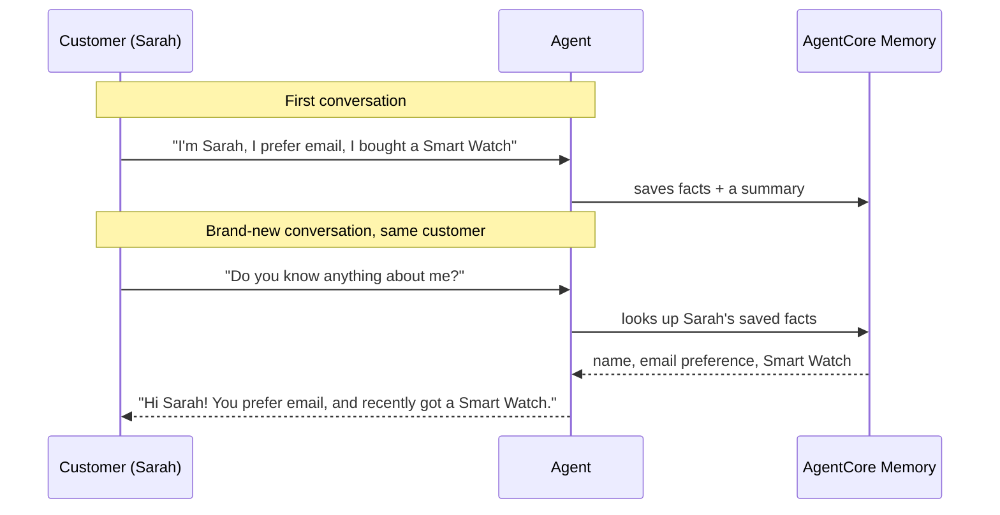

# Lab 2 — Add Memory to Your Agent

## The problem, in plain terms

The agent from Lab 1 has goldfish memory. The moment a conversation ends, everything's gone. Come back five minutes later, and it has no idea who you are.

## Why this actually matters

Imagine telling a support bot your name, your order number, and that you already tried restarting the device — then having to repeat all of it the next time you open the chat. That's not just annoying, it's actively worse than talking to a human, who'd at least glance at your account history. A lot of teams think they've solved this because it "remembers" things fine *within* one long conversation. That's a trap — it only looks solved until a real customer comes back a day later in a brand-new chat window.

## What AWS gives you to fix this

AgentCore Memory stores information outside of any single conversation, so it survives even when the conversation ends. It works two ways: it remembers specific facts (your name, your preferences, what you bought) and it keeps a compressed summary of past conversations for context. Each customer's memories are kept separate automatically — you don't have to write that separation logic yourself.

## What I actually did

1. Turned on memory for the agent with one command, using two memory types: facts and summaries.
2. Connected that memory to the agent's code, so it knows which customer to look up facts for.
3. Changed the agent to create one "instance" per customer conversation, so memories don't get mixed up between different people.
4. Deployed the updated agent — memory only works once it's live in the cloud.
5. Ran the real test: told the agent my name and a preference, then — in a **completely new conversation** — asked "do you know anything about me?" It did.

## How it fits together

*My own diagram explaining the test this lab walks through — not an official AWS diagram. Source: AWS Workshop Studio, Lab 2 ("Add Memory to Your Agent").*

## The one thing worth remembering

There's a real difference between "remembers within one chat" (free, automatic, no setup) and "remembers you next time you come back" (needs AgentCore Memory, like this lab sets up). The only way to actually prove you've built the second one is to end the conversation completely and start a fresh one. If your test never does that, you haven't actually tested memory — you've just tested a conversation that never ended.

## What I actually tested, not just read about

I ran the real test myself: taught the agent a name and a preference in one chat, then opened a totally new session and asked if it remembered me. It did, correctly, both times I tried it. I also waited long enough for the AWS server behind the scenes to shut down and restart, and the agent still remembered — proof it's real stored memory, not just a conversation that happened to still be open.

## Want the real thing? Go here

- The actual lab, with all the real code: [AWS Workshop Studio — Lab 2: Add Memory to Your Agent](https://catalog.us-east-1.prod.workshops.aws/workshops/c770f35f-90a9-4e02-8985-4ef912bddb77/en-US/30-lab2-memory)
- [Amazon Bedrock AgentCore Memory — official docs](https://docs.aws.amazon.com/bedrock-agentcore/latest/devguide/memory.html)
