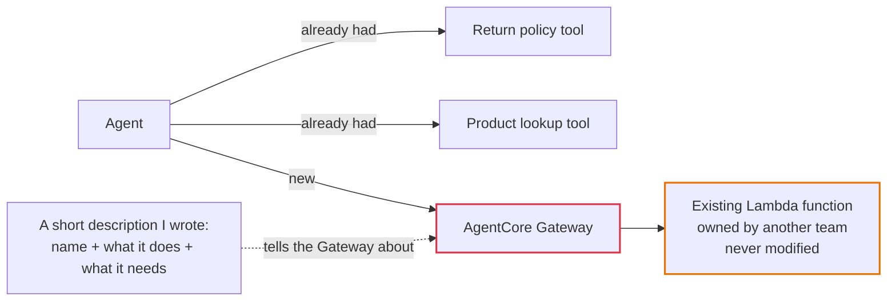

# Lab 3 — Scaling Tools with Gateway

## The problem, in plain terms

Real companies already have working systems — a warranty-check service, an order database, an internal API — built long before anyone thought about AI agents. Your agent can't use any of them yet, because they weren't built to be called by one.

## Why this actually matters

You've got two bad choices here. Either you rebuild that warranty-check logic *inside* your agent's own code (now you've got two copies of the same logic, and they'll quietly drift apart every time one gets updated and the other doesn't), or you just don't give your agent that ability at all, so it can't answer the exact questions customers are going to ask it. Neither is good enough for something you're putting in front of real customers.

## What AWS gives you to fix this

AgentCore Gateway acts like a translator sitting in front of an existing system. You don't touch that system's code at all — you just write a short description (a "schema") explaining what it does and what inputs it needs. The Gateway uses that description to make the old system look like a normal tool the agent can call. One Gateway can do this for multiple different systems at once, not just one.

## What I actually did

1. Found the existing system to connect — in this lab, a Lambda function (a small piece of AWS-hosted code) that checks product warranties, already running and owned by a different team.
2. Wrote a short description of that function: what it's called, what it does, what input it needs. I didn't touch the function's actual code at all.
3. Created a Gateway and pointed it at that function using the description.
4. Told my agent about the Gateway — it now sees the warranty-check function as just another tool, right alongside the ones it already had.
5. Deployed and tested it — asked the agent to check a warranty, and it correctly called the Gateway, which called the Lambda, which gave back the real answer.

## How it fits together

*My own diagram explaining the mechanism — not an official AWS diagram. Source: AWS Workshop Studio, Lab 3 ("Scaling Tools with Gateway").*

**What this picture is really saying:** the box on the right (the existing system) and the box with the description are owned by two completely different people, and the only thing connecting them is a short write-up — not shared code.

## The one thing worth remembering

Your agent's tools don't have to live inside your agent's own project. A Gateway turns "copy someone else's code into my app" into "write one short description of what their system does." That's a much smaller, safer change — and it means the team who owns the warranty system keeps owning it.

## What I actually tested, not just read about

I deployed the Gateway and asked the agent two real questions — one about a product with an expired warranty, one with an active warranty — and both came back correct, pulled live from the existing Lambda function through the Gateway.

## Want the real thing? Go here

- The actual lab, with all the real code: [AWS Workshop Studio — Lab 3: Scaling Tools with Gateway](https://catalog.us-east-1.prod.workshops.aws/workshops/c770f35f-90a9-4e02-8985-4ef912bddb77/en-US/40-lab3-gateway)
- [Amazon Bedrock AgentCore Gateway — official docs](https://docs.aws.amazon.com/bedrock-agentcore/latest/devguide/gateway.html)
- [Model Context Protocol (MCP) — the open standard Gateway speaks](https://modelcontextprotocol.io/)
