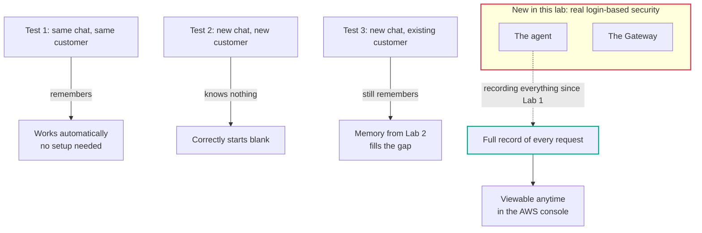

# Lab 4 — Securing and Observing in Production

## The problem, in plain terms

By default, your agent is locked behind AWS's own credentials — so random strangers on the internet can't call it, which is good. But that's an all-or-nothing lock: it can't tell *which* customer is talking to it. And right now, if the agent gives a wrong answer, there's no way to see what actually happened inside that conversation.

## Why this actually matters

Without a way to identify individual customers, you're stuck choosing between handing out real AWS credentials to every customer (a genuinely bad idea) or not being able to personalize anything at all. And without visibility into what the agent actually did, when something goes wrong in front of a real customer — and eventually something will — you're left guessing. Was it the wrong tool? A memory that didn't load? The model itself? Without evidence, debugging becomes "maybe try this and see if it happens again," which is a bad place to be during a live customer complaint.

## What AWS gives you to fix this

Two separate things, and the lab is careful not to blur them together. First: AgentCore Runtime has been quietly recording everything — every request, every tool call, every response — since the very first lab, with zero setup required. You just ask to see it. Second: this lab adds real login-based identity (via Amazon Cognito) so the agent can actually tell different customers apart, instead of treating every caller the same.

## What I actually did

1. Proved "remembers mid-chat" works for free: same conversation, same customer, agent remembers without any special setup.
2. Proved a brand-new conversation for a brand-new customer starts completely blank — no leftover context from anyone else.
3. Proved memory from Lab 2 bridges the two: a brand-new conversation for an *existing* customer still recalls their facts, because that's stored separately from the live conversation.
4. Pulled real records of what the agent actually did — which tool it called, what it said, how long each step took — using commands that needed no extra setup at all.
5. Turned on proper login-based security (Cognito), so the agent can now tell real customers apart instead of treating every request the same.

## How it fits together

*My own diagram explaining the mechanism — not an official AWS diagram. Source: AWS Workshop Studio, Lab 4 ("Securing and Observing in Production").*

## The one thing worth remembering

"It remembered me in this chat" and "it remembers me when I come back" are two completely different claims, and the only way to know which one you've actually built is to run both tests, not just the one that happens to pass. Also worth knowing: you don't need to "add monitoring later" — it's already there from day one, whether you've looked at it yet or not.

## What I actually tested, not just read about

I ran all three tests myself, back to back, and got the expected result every time. I also pulled a real, detailed record of one actual request and read through exactly what the agent did at each step — what it was asked, what memory it loaded, which tool it called, and what it answered.

## Want the real thing? Go here

- The actual lab, with all the real code: [AWS Workshop Studio — Lab 4: Securing and Observing in Production](https://catalog.us-east-1.prod.workshops.aws/workshops/c770f35f-90a9-4e02-8985-4ef912bddb77/en-US/50-lab4-deploy)
- [Amazon Bedrock AgentCore Observability — official docs](https://docs.aws.amazon.com/bedrock-agentcore/latest/devguide/observability.html)
- [Amazon Cognito — official docs](https://docs.aws.amazon.com/cognito/latest/developerguide/cognito-user-identity-pools.html) (the login/identity service used here)
