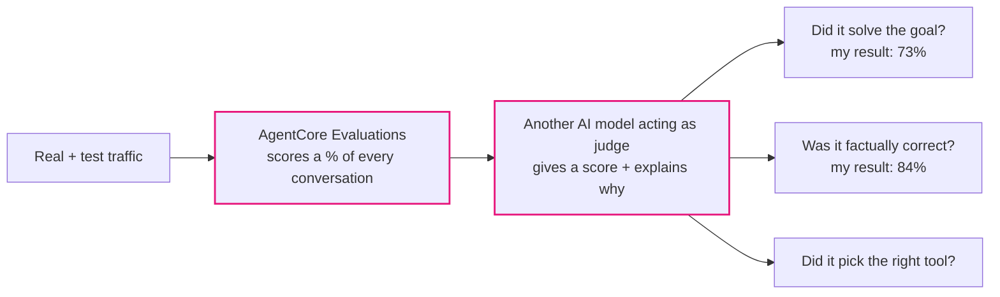

# Lab 5 — Evaluating Agent Quality

## The problem, in plain terms

The agent is live, secured, and every request is being recorded. But none of that tells you whether it's actually giving *good* answers.

## Why this actually matters

"It's running" and "it's good" quietly turn into the same sentence if nobody's checking. An agent can be fast, online, and fully logged while still being wrong a third of the time — picking the wrong tool, inventing a product that doesn't exist, or technically replying without actually solving the customer's problem. Nobody notices until complaints start piling up or a customer posts about it publicly, and by then it's a reputation problem instead of a quiet bug fix.

## What AWS gives you to fix this

AgentCore Evaluations uses another AI model as a "judge" to automatically score how the agent is doing on real traffic — not just pass/fail, but with a written explanation for *why* it scored something the way it did. AWS ships 13 ready-made scoring types you can turn on, and you choose what percentage of traffic gets checked.

## What I actually did

1. Turned on automatic scoring for the live agent, picking 3 of the 13 available checks: did it solve the customer's goal, was the information actually correct, and did it pick the right tool.
2. Deployed that configuration — scoring starts automatically from that point on.
3. Sent the agent a batch of varied test questions on purpose, so there was real traffic for the judge to score.
4. Asked for a report on the last day of activity and got back real numbers, not a guess.
5. Dug into *why* one score was lower than another, using the judge's written explanation for that specific answer.

## How it fits together

*My own diagram explaining the mechanism — not an official AWS diagram. Source: AWS Workshop Studio, Lab 5 ("Evaluating Agent Quality").*

## The one thing worth remembering

"The demo worked" and "the agent is actually good" are different claims, and most teams only ever check the first one. A judge model that can explain *why* it marked something wrong — for example, pointing out the agent made up a product ID the customer never mentioned — turns a vague feeling that something's off into an actual bug you can go fix.

## What I actually tested, not just read about

I ran real test traffic through the live agent and got back real scores (around 73% on "solved the goal" and 84% on "factually correct" for my run — these numbers will vary depending on what traffic you send). I also read the detailed, per-answer explanation behind a lower score to see exactly what went wrong.

## Want the real thing? Go here

- The actual lab, with all the real code: [AWS Workshop Studio — Lab 5: Evaluating Agent Quality](https://catalog.us-east-1.prod.workshops.aws/workshops/c770f35f-90a9-4e02-8985-4ef912bddb77/en-US/60-lab5-evals)
- [Amazon Bedrock AgentCore Evaluations — official docs](https://docs.aws.amazon.com/bedrock-agentcore/latest/devguide/evaluations.html)
