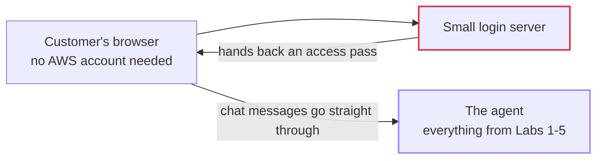

# Lab 6 — Building the Customer Interface

## The problem, in plain terms

Everything built in Labs 1 through 5 is real, live, and working — and a real customer can't reach any of it. Right now, using the agent requires a terminal and a special access code, which no normal customer has or wants.

## Why this actually matters

This is a surprisingly common way for good work to go to waste: a team spends weeks building a solid agent — memory, shared tools, security, quality checks — and then never gets around to the part a customer can actually open and use. All that effort delivers zero real value until someone who isn't an engineer can click a button and start typing.

## What AWS gives you to fix this

The fix is a small web page with a chat box. A lightweight server handles the login step (so no customer needs AWS credentials), then gets out of the way — the customer's browser talks to the agent directly after that, the same way the CLI did in earlier labs, just with a friendlier interface.

## What I actually did

1. Built a small web server whose only job is to log the customer in and hand their browser a temporary access pass.
2. Built a one-page chat interface — type a message, see the agent's reply.
3. Made sure the actual chat messages go straight from the browser to the agent, not routed back through my own server first — keeps things simple and fast.
4. Tested it for real: asked about products, return policy, and a warranty check, all through the browser instead of a terminal.
5. Tested session behavior on purpose: started a new chat and confirmed it forgot the current conversation but *still* remembered saved facts about me from before — the same memory-vs-session distinction from Labs 2 and 4, now visible in an actual chat window instead of a command line.

## How it fits together

*My own diagram explaining the mechanism — not an official AWS diagram. Source: AWS Workshop Studio, Lab 6 ("Building the Customer Interface").*

## The one thing worth remembering

A solid backend isn't a finished product — it's finished when someone who isn't you can open a browser and actually use it. One more thing worth knowing if you build something like this for real: the simple login method used in this workshop lab is explicitly called out by AWS as a shortcut for learning purposes only — a real production app needs a more robust login flow, not this exact setup.

## What I actually tested, not just read about

I opened the chat page in a real browser and tried all four test questions (products, return policy, warranty, "do you remember me?"), then deliberately started a new chat to confirm it forgot the current conversation but still recalled saved facts from before.

## Want the real thing? Go here

- The actual lab, with all the real code: [AWS Workshop Studio — Lab 6: Building the Customer Interface](https://catalog.us-east-1.prod.workshops.aws/workshops/c770f35f-90a9-4e02-8985-4ef912bddb77/en-US/70-lab6-frontend)
- [AgentCore Runtime — calling it over the web, official docs](https://docs.aws.amazon.com/bedrock-agentcore/latest/devguide/runtime-invoke.html)
- [Amazon Cognito — the production-correct login flow](https://docs.aws.amazon.com/cognito/latest/developerguide/authorization-endpoint.html) (not the shortcut this lab uses)
